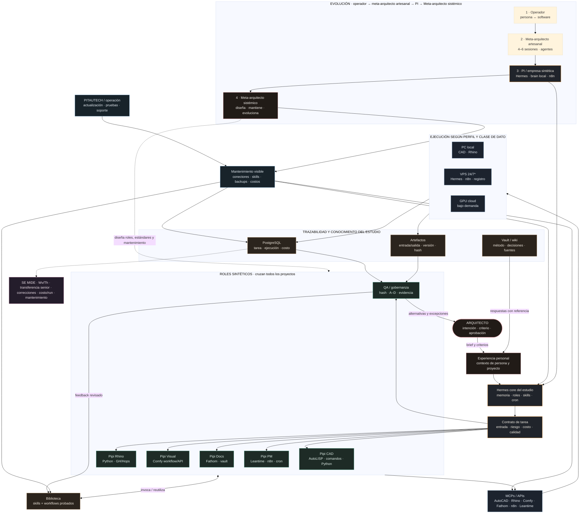

# Arquitectura de PI — sistema operativo de capacidades

> Gráfico técnico y de producto de PI: integra la conversación «Diseño del sistema operativo», la tesis del Meta-arquitecto sistémico y la empresa sintética con las decisiones vigentes en [[proyectos/MVP_07-studio-os-sistema/VISION|VISION]], [[proyectos/MVP_07-studio-os-sistema/ESTRUCTURA|ESTRUCTURA]] y [[proyectos/MVP_07-studio-os-sistema/REQUISITOS|REQUISITOS]].
> **Fuentes**: análisis en [[specs/261101-doc-chatgpt-diseno-pi-os|specs/261101]], guion de producción en [[specs/261101-guion-visual-pi-remotion|specs/261101-guion-visual]], transcripción cruda en [[raw/reuniones/2026-11-01-chatgpt-diseno-sistema-operativo-pi|raw/reuniones/2026-11-01]]. La página web y el video abren este mapa como dibujo animado.
> **Código**: [[diagramas/arquitectura-pi-os|arquitectura-pi-os.mmd]] (mermaid editable).

## 1 · El gráfico

> La vista de abajo es la síntesis ejecutiva. El editable [[diagramas/arquitectura-pi-os|.mmd]] añade el inventario de MCP, los lenguajes por rol, los destinos de ejecución, el circuito de aprendizaje y el mantenimiento.

## 2 · Cómo leerlo

- **El Meta-arquitecto es el cierre del relato**: diseña, gobierna, mantiene y amplía PI. La empresa sintética es el sistema que construye; los arquitectos de proyecto usan sus capacidades sin operar la arquitectura técnica.
- **Núcleo vigente**: un Hermes por estudio, según [[proyectos/MVP_07-studio-os-sistema/VISION#6.9 Las decisiones ya tomadas|VISION §6.9]]. Un asistente por arquitecto se plantea como perfil/contexto personal sobre un núcleo común; instancias Hermes aisladas por persona requieren una decisión de producto/arquitectura.
- **La unidad que crece** es la biblioteca de capacidades (skills versionadas con dependencias y validación); los agentes las consumen. «La verdadera unidad de crecimiento de PI no es la cantidad de agentes instalados sino la cantidad de capacidades verificadas que puede poner a disposición de cada estudio».
- **Los entornos de ejecución son intercambiables**: el agente no decide dónde vive el trabajo pesado; lo decide el perfil de la tarea (local si la GPU está libre, cloud si está ocupada, programado si la app vive en una PC apagada). Eso es el **PI Resource Manager** propuesto, a construir sobre el sobre de tarea del vault.
- **Toda ejecución queda registrada; C/D esperan aprobación explícita**: la regla de gobernanza A–D ya formalizada en [[proyectos/MVP_07-studio-os-sistema/REQUISITOS#7 · Gobernanza por nivel de riesgo|REQUISITOS §7]].
- **Aprendizaje no equivale a entrenamiento**: memoria de trabajo, skills aprobadas y ajuste de pesos son mecanismos separados.
- **La deuda técnica se hace gestionable**: scripts, conectores, workflows, seguridad, backups, compatibilidad y soporte pasan a un ciclo visible de mantenimiento.
- **La medición** es la que permite demostrar el salto: mismas horas humanas, más capacidad — tiempo humano, tiempo efectivo de ejecución, tiempo de espera, tareas validadas, reutilización y **producción desacoplada del tiempo humano**.
- Mapeo con el vault: los entornos coinciden con los nodos de [[proyectos/MVP_07-studio-os-sistema/ESTRUCTURA#1 · Vista general|ESTRUCTURA §1]] (VPS · PC del estudio · banco · GPU nube). Telegram es la interfaz cotidiana vigente; una web multiusuario queda como producto posterior.
- **Personal vs. compartido:** VISION mantiene un Hermes core por estudio. PI puede ofrecer al arquitecto un perfil/contexto de trabajo personal sobre ese núcleo; aislar una instancia por persona queda como decisión a evaluar.

## 3 · Variantes de despliegue (las 3 configuraciones de la conversación)

| | A · Económica | B · Híbrida (predilecta) | C · Control total |
|---|---|---|---|
| Cómo | VPS + PC + GPU cloud bajo demanda, máximo aprovechamiento de lo existente | VPS (núcleo) + estaciones ejecutoras + GPU cloud + interfaz web | servidor propio, GPU dedicada, NAS redundante, modelos locales |
| Fortaleza | coste mínimo | cada tarea corre donde es más eficiente | soberanía sobre datos, modelos y ejecución |
| Limitación | capacidades locales atadas a PCs encendidas | gestionar conectividad y disponibilidad | inversión y mantenimiento de hardware |

**Perfil predilecto: B, híbrido.** El MVP_07 diseña un núcleo persistente en VPS, estaciones locales para CAD/geometría y GPU cloud como excepción. La composición lo presenta como dirección de despliegue; cada integración y estación se valida por fase en [[proyectos/MVP_07-studio-os-sistema/IMPLEMENTACION-HERMES|IMPLEMENTACION-HERMES]].

## 4 · Gráfico para explicar (la cara pública)

- `diagramas/prompt-coach-vs-agentico.html` — presentación visual **operador → meta-arquitecto artesanal → PI/empresa sintética → Meta-arquitecto sistémico**, con flujo aumentado, casos MVP, lenguajes de herramientas, mantenimiento, MCPs, privacidad, fórmula y fuentes.
- `diagramas/arquitectura-pi-os.mmd` — el mapa técnico editable (mermaid).
- `P:\00-repos\remotion-vault\src\PIStudioOS.tsx` — composición Remotion `03-PIStudioOS`, ocho escenas animadas del flujo a empresa sintética.
- [[scripts/00-index|scripts]] — `auditar_presentacion_pi.py` valida archivos, MCPs activos y anclas de contenido (solo lectura).

## 5 · Relación con otros diagramas

- [[diagramas/cerebro-hermes-fractal|cerebro-hermes-fractal]] — la memoria fractal del vault (dónde piensa Hermes).
- [[diagramas/flujo-fuentes-wiki-hermes|flujo-fuentes-wiki-hermes]] — el ciclo del conocimiento (tex → wiki → Hermes).
- [[diagramas/agentes-fuentes|agentes-fuentes]] — el circuito de los agentes Sherlock/contenidos.
- [[proyectos/MVP_07-studio-os-sistema/ESTRUCTURA|ESTRUCTURA]] — la arquitectura formal con ADR del MVP_07.
