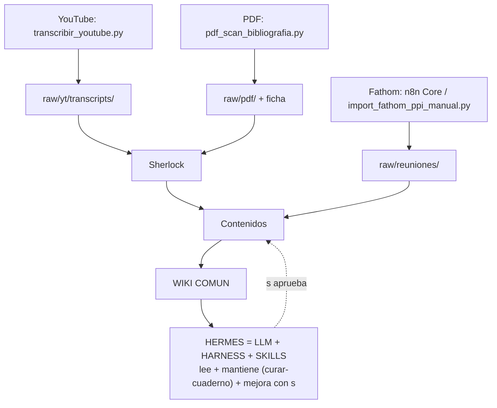

# Flujo fuentes → wiki → Hermes (replicable)

Cada fuente tiene su flujo y su script. Hermes replica ejecutando la misma tabla. Ver visión en [[proyectos/MVP_07-studio-os-sistema/VISION|VISION]] §2 y §4, y el filo en [[specs/261029-filo-vault-v2|filo-vault-v2]].

![[diagramas/flujo-fuentes-wiki-hermes.drawio.svg|900]]

Editable: [[diagramas/flujo-fuentes-wiki-hermes.drawio|drawio]] · texto replicable: [[diagramas/flujo-fuentes-wiki-hermes.mmd|mmd]].

## Tabla replicable (fuente → script → raw → agente)

| Fuente | Script / flujo | Raw destino | Agente que sigue |
|---|---|---|---|
| YouTube suelto | `scripts/transcribir_youtube.py <url>` | `raw/yt/transcripts/` | Sherlock ficha |
| Takeout YT/Chrome | `scripts/yt_titles.py` → `scripts/yt_takeout_parser.py` → `scripts/yt_revision.py` | `raw/yt/` | Sherlock + Contenidos |
| Curso Mux | `scripts/mux_lecciones_curso.py <html>` | `raw/yt/transcripts/` + `indice-curso-ai-gaudi.json` | Sherlock ficha |
| Lección sin subtítulos | `scripts/transcribir-leccion-bunny.py --modulo <x>` | `raw/yt/transcripts/` + `activos/` | Sherlock ficha |
| Tablero Miro | `scripts/miro_board_inventory.py --url <board>` | `raw/research/` | Sherlock candidatos |
| PDF / bibliografía | `scripts/pdf_scan_bibliografia.py` | `raw/pdf/` + ficha | Sherlock → Contenidos |
| Reunión Fathom | n8n Fathom Core (cron) o `scripts/import_fathom_ppi_manual.py` | `raw/reuniones/` | Fathom-PM → Leantime |
| IG / Pinterest / obra | `scripts/referentes_pinterest.py` + `scripts/referentes_tags.py` | `activos/referentes/` | Vaultworm conecta |

## Hermes: lee, mantiene, mejora (Karpathy)

Composición (de [[proyectos/MVP_07-studio-os-sistema/VISION|VISION]] §4): **LLM intercambiable** (OpenCode Go → Ollama → OpenRouter) + **HARNESS** (Docker, MCPs-brazos, cron, Telegram, registro Postgres) + **SKILLS** (procedimientos escritos: `curar-cuaderno`, `auditar-documentacion-cad`, `experto-comfyui`).

- **Lee**: `vault-mcp` (leer/buscar/índice). La memoria real es el cuaderno digital; la de Hermes es scratch.
- **Mantiene**: skill `curar-cuaderno` (indexar, etiquetar, conectar) + cron digest 07:00 + lint trimestral.
- **Mejora**: propone entradas y refunds, siempre con `s` humano antes de escribir.

Punto Karpathy ([[wiki/glosario/conceptos/cerebro-digital-karpathy|cerebro-digital]]): el trabajo está en el harness y en el pipeline raw → compilado → query, no en el modelo. Los agentes se abandonan cuando nadie mantiene ese harness; Hermes lo mantiene, por eso no se abandona.

