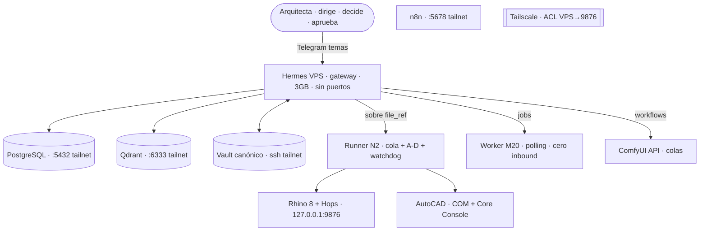

# PI — Ingeniería de sistemas (C4 + despliegue + secuencia) — documento cerrado

> Versión refinada del [[specs/261102-system-overview-pi|system overview]]. Convención: C4 L1 contexto → L2 contenedores → L3 componentes → despliegue → secuencia. Editable en `.mmd`, formal en draw.io cuando avance a G1-G3.
> Base: [[proyectos/MVP_07-studio-os-sistema/VISION|VISION]] · [[proyectos/MVP_07-studio-os-sistema/ESTRUCTURA|ESTRUCTURA]] · [[proyectos/MVP_07-studio-os-sistema/REQUISITOS|REQUISITOS]] · [[proyectos/MVP_07-studio-os-sistema/IMPLEMENTACION-HERMES|IMPLEMENTACION-HERMES]] · [[specs/261102-plan-maestro-pi-por-temas|plan maestro]].

## V1 Contexto C4-L1 — validado

Sistema PI como sistema operativo de capacidades: arquitecta dirige, agentes ejecutan, memoria evoluciona. Gráfico oficial: [[diagramas/arquitectura-pi-os|arquitectura-pi-os.mmd]].

## V2 Stakeholders — quién decide qué

Titular decide y aprueba C/D. Arq 2 ejecuta A/B y pide C/D. Operador instala y mantiene con perfil aparte. Cliente solo recibe entregables. Hermes prepara y ejecuta, nunca decide.

Detalle editable: [[diagramas/pi-stakeholders|pi-stakeholders.mmd]].

## V3 BPMN As-Is → To-Be — 10 pasos del estudio

Hoy manual con carpetas y memoria en cabezas. Con PI cada paso deja registro y procedencia: mini CRM → minuta con fecha → aviso Telegram → cuaderno digital → auditoría CAD → Hops → portal con metadata → visita con tags → paquete que envía persona → memoria computable.

Detalle editable: [[diagramas/pi-bpmn-asis-tobe|pi-bpmn-asis-tobe.mmd]].

## V4 Journeys — pedir → aprobar → recibir

Pide por Telegram con texto o croquis, Hermes interpreta y propone plan, persona aprueba en el teléfono si es C/D, runner o GPU ejecuta, portal entrega con informe y procedencia, registro guarda todo.

Detalle editable: [[diagramas/pi-journeys|pi-journeys.mmd]].

## L2 Contenedores — dónde vive cada pieza y por qué protocolo

Detalle completo editable: [[diagramas/pi-system-ingenieria-c4|c4.mmd]].

## L3 Componentes Hermes — tu ASCII mapeado a PI

Entry points → Prompt Builder (SOUL+AGENTS+skill) → Provider (Go/Ollama/OpenRouter) → Dispatch (manual + deny + A-D) → Registry (7 Pipis) → Backends (terminal/MCP/File/Vision/Web) → Storage (SQLite+Postgres+vault+Qdrant).

Detalle completo editable: [[diagramas/pi-system-ingenieria-componentes|componentes.mmd]].

## E4 ER Registro — qué guarda el sistema

Proyecto, archivo, versión, tarea, ejecución, artefacto, relación y aprobación con persona, hora y hash. Grafo como vista para marcar `stale` y proponer rehacer.

Detalle editable: [[diagramas/pi-er-registro|pi-er-registro.mmd]].

## R1 Casos de uso — C-01 a C-13

Alta cliente, reunión, recordatorio, mail, auditoría CAD, comparar versiones, entrega, validar IFC, variantes visuales, modelo 3D, visita obra, cuaderno digital y qué sé del proyecto.

Detalle editable: [[diagramas/pi-casos-uso|pi-casos-uso.mmd]].

## R4 Máquina de estados — cómo viaja una tarea

Pendiente → validando → espera si C/D → ejecutando → hecha o fallida o no disponible → stale si cambia el insumo → pendiente para rehacer. Reintento con misma `idem_key` evita duplicar.

Detalle editable: [[diagramas/pi-maquina-estados|pi-maquina-estados.mmd]].

## Despliegue + secuencia — cómo viaja una tarea

N1 VPS ↔ N2 Windows ↔ N3 M20 ↔ N4 GPU por tailnet, con volúmenes nombrados y secretos en `.env` 600. Secuencia: pide → interpreta → valida riesgo → aprueba si C/D → ejecuta con provenance → registra y marca `stale` si la versión cambia.

Detalle completo editable: [[diagramas/pi-system-ingenieria-despliegue|despliegue.mmd]].

## Contratos entre piezas

| Interfaz | Protocolo | Qué valida |
|---|---|---|
| Telegram → Hermes | allowlist + pairing + botones | chat_id + aprobación en canal origen |
| Webhook → n8n | HMAC + filtros + coalesce | firma + idempotencia 1h |
| Hermes → Runner | HTTPS tailnet + token por job | file_ref resoluble + riesgo + idem_key |
| Hermes → ComfyUI | API + colas | workflow versionado + R4 contra object_info |
| Hermes → Postgres | API escritura única | provenance completa, nada directo a base |
| Vault ↔ agentes | git ssh tailnet + MCP vault | frontmatter + wikilinks + `s` para escribir |

## Qué es cada documento

* **VISION** — qué es PI y para quién. Problema, recorrido del estudio, cuaderno, Hermes en concepto. Pregunta ¿qué y por qué?
* **ESTRUCTURA** — dónde vive cada pieza y cómo se conecta. Nodos, agente, integraciones, contrato, registro, seguridad. Pregunta ¿dónde y cómo?
* **REQUISITOS** — qué cumple y cómo se mide. Casos, RF/RNF, criterios, gobernanza, métricas, plan. Pregunta ¿qué exige y cómo se prueba?
* **IMPLEMENTACION-HERMES** — traducción a piezas reales de Hermes, qué configura y qué no puede.
* **GUIA-LECTURA** — ruta de lectura por tema.
* **SPEC** — especificación técnica de diseño. **ADR** — acta de decisión con contexto, opciones y consecuencias.

## Siglas

* **RF** funcional, lo que hace. **RNF** no funcional, cómo lo hace. **AC** criterio Dado/Cuando/Entonces. **C-01** casos de uso.
* **MVP** corte mínimo que ya sirve. **BPMN** procesos, **UML** estándar software, **C4** contexto/contenedores/componentes, **ER** entidades de base.
* **MCP** enchufe del agente, **API** puerta entre programas. **VPS** compu siempre encendida, **GPU** placa imagen/video.
* **A-D** niveles: A lee, B genera aislado, C modifica con aprobación, D publica con aprobación explícita. **SOUL** identidad del agente. **Hops** Grasshopper sin pantalla.

## Trazabilidad

ADRs en [[proyectos/MVP_07-studio-os-sistema/ESTRUCTURA#10 · Decisiones técnicas|ESTRUCTURA §10]]: Hermes único, puente P1+P3, registro híbrido, Runpod Secure, vault canónico, Tailscale. Criterios en [[proyectos/MVP_07-studio-os-sistema/REQUISITOS#6 · Criterios de aceptación|REQUISITOS §6]].
