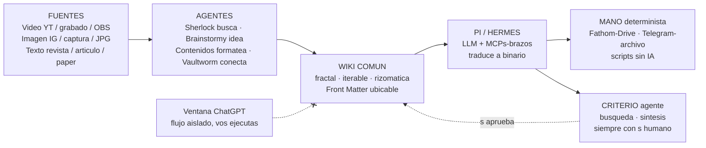

# Prueba comparativa — mismo diagrama en 3 formatos

Mismo contenido G1 (Fuentes → Agentes → Wiki → Pi/Hermes → Mano/Criterio). Abrí este archivo en Obsidian y compará scroll / nitidez / peso.

## 1. Mermaid (texto, nativo, recomendado)

Fuente: `[[diagramas/prueba-comparativa.mmd|prueba-comparativa.mmd]]` — texto plano, git diff limpio, Pi lo lee.

## 2. draw.io / diagrams.net (SVG acotado, sin scroll)

![[diagramas/prueba-comparativa.drawio.svg|750]]

Editable en `[[diagramas/prueba-comparativa.drawio|prueba-comparativa.drawio]]` (abrir en app.diagrams.net o desktop). Export SVG con ancho fijo 750 — no scrollea.

## 3. Excalidraw (canvas, estilo boceto)

> El `.excalidraw.md` vivo necesita el community plugin **Excalidraw** instalado y activado en Obsidian — tu vault no lo tiene (carpeta `.obsidian/plugins` inexistente), por eso ves código en vez del dibujo. Pasos: Ajustes → Community plugins → Activar → Buscar Excalidraw → Instalar → Activar; luego abrir el archivo con `⋯ → Open as Excalidraw`.

Vista previa estática (sin plugin):

![[diagramas/prueba-comparativa.excalidraw.svg|700]]

Fuente viva (requiere el plugin): `[[diagramas/prueba-comparativa.excalidraw.md|prueba-comparativa.excalidraw.md]]` — canvas 700×300, JSON validado (18 elementos).

## Veredicto a completar por vos

| Formato | Scroll | Nitidez | Peso git | Edición | Capacidad destacada | ¿Te gusta? |
|---|---|---|---|---|---|---|
| Mermaid | no | media | texto plano, diff limpio | código (Pi lo genera) | flowcharts, sequence, gantt; limitado en estilo |  |
| draw.io SVG | no (ancho fijo) | alta, formal | svg+drawio, diff legible | app/desktop/plugin Obsidian (desktop-only) | UML/BPMN/C4, librerías AWS/redes/planos, capas, links a notas en lectura, importa Mermaid y Visio |  |
| Excalidraw | sí si no se acota | boceto mano alzada | json ~13 KB, diff ruidoso | canvas en Obsidian + mobile | croquis rápido 30 seg, anotar capturas, transcluir notas con backlinks |  |
