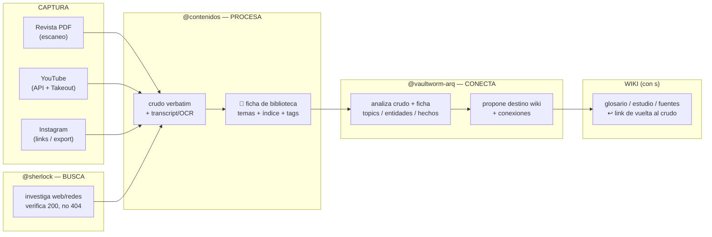
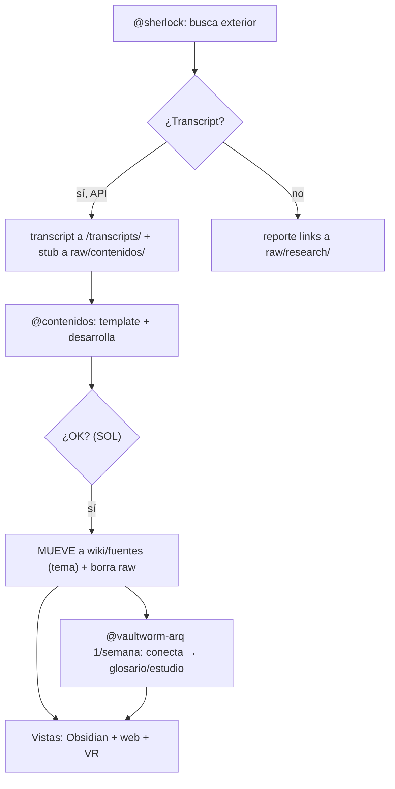

# Spec — Ecuación de ingesta de fuentes de arquitectura

_Fecha: 2026-10-09 · Estado: v5 — flujo adelgazado (Sherlock slim + stub pendiente-formato + Vaultworm semanal) · Relacionado: `specs/260909-plan-accion-web-research-moodboard-youtube.md`, `raw/brainstorm/b-2026-10-08-vault-web-drive-ingest.md`_

## 1. Objetivo

Definir **una sola ecuación de ingesta** que sirva para todos los tipos de fuentes del estudio (revistas, YouTube, Instagram, PDFs, audio, fotos, planos) y que alimente dos bowls: el personal (Sol / Emilia por separado) y el **catálogo compartido mergeado** en el vault.

## 2. Principios (no se reabren — decididos 2026-10-08)

1. **Un pipeline, N extractores**: `Captura → Crudo verbatim (raw/) → Ficha de curaduría → Catálogo → Wiki (con s)`.
2. **Curaduría manual primero, "sin ficha no entra"**: nada llega al catálogo compartido sin ficha con tags.
3. **Binarios en `activos/`, nunca en git**: los `.md` solo referencian rutas.
4. **Append-only en `raw/`**: el crudo no se edita jamás; los temas viven en la ficha, no en el crudo.
5. **Vocabulario controlado común**: Sol y Emilia taggean con la misma lista o el merge no sirve.

## 3. Tipos de fuente y procesamiento

### 3.1 Revista de arquitectura en PDF (escaneo: texto + imágenes)

**Caso base**: revista escaneada, sin texto embebido, con 5 secciones típicas (pensamiento / obras de un autor / sistemas constructivos / tipologías / delicias). Emilia aporta ~20 revistas físicas → escáner → PDF.

| Capa | Proceso | Herramienta | Destino |
|---|---|---|---|
| Texto | OCR por página, conservando nº de página como cita | Tesseract (a instalar en comfyenv; ya figura como pendiente en `scripts/00-index.md`) | `raw/fuentes/revistas/<revista>-<nro>/texto/p<pag>.md` |
| Imágenes | Extracción con página + bbox; **sin visión por computadora** | PyMuPDF/fitz (a instalar; hoy no está en comfyenv) | `activos/revistas/<revista>/<nro>/img/p<pag>-<n>.jpg` (JPEG q=70, max 1024px) |
| Tag de imagen | Dos fuentes: **epígrafe** (bloque de texto más cercano a la imagen en la misma página) + **sección heredada** (encabezado o índice de la revista) | Heurística en script `revista_ingest.py` (a crear) | Ficha sidecar 1:1 |
| Ficha | 1 `.md` por imagen: epígrafe verbatim + tags + sección + fuente + página | Manual + script | `activos/revistas/<revista>/<nro>/img/p<pag>-<n>.md` |
| Anti-inundación | pHash anti-duplicados, tope 50/día | ya decidido 08/10 | — |

### 3.2 YouTube (API + guardados)

**Ecuación**: dos vías complementarias, porque la API v3 **no expone Watch Later**.

| Vía | Qué trae | Cómo | Cadencia |
|---|---|---|---|
| API v3 (automática) | Suscripciones + playlists nombradas + metadatos (título, canal, duración) | `scripts/yt_titles.py` con `YOUTUBE_API_KEY` (ya operativo; gasto 14/10000) | Semanal |
| Takeout (manual, 5 min) | Watch Later + historial + bookmarks Chrome | Export de Google Takeout → `scripts/yt_takeout_parser.py` (ya operativo, 709 videos verificados) | Mensual |

**Bowls**: cada uno corre el flujo con su Takeout + su key → bowl personal (`raw/yt/` Sol, `raw/yt-emilia/` Emilia) → **merge por `video_id`** al catálogo compartido `raw/yt/videos-y-canales-guardados.md` con campo **"quién guardó"**. Las carpetas con nombre a elección son las listas de YouTube tal cual + bowls temáticos del vault. Procesamiento profundo (transcript → `@contenidos` → `wiki/fuentes/<slug>.md`) solo para lo marcado en scope, de a 1 video por vez (piloto ComfyUI en curso, 71 videos).

### 3.3 Instagram (a analizar por el Agente 1)

Sin API pública práctica para guardados; opciones a evaluar en orden de costo:

1. **Links curados a mano** (recomendado para empezar): tabla de URLs de posts guardados → `webfetch` por link → ficha por post (imagen referenciada + **caption como tag natural** — mismo rol que el epígrafe de revista — + autor + tags). Cero tooling nuevo.
2. **"Download your data" de Instagram**: export manual (como Takeout) con `saved_posts.json` → parser hermano de `yt_takeout_parser.py`. A verificar qué trae el export 2026.
3. **Scraping/embed** (último recurso): frágil ante cuentas privadas y login; solo si 1 y 2 fallan.

### 3.4 Otras fuentes (mismo pipeline, extractor distinto)

| Fuente | Extractor | Estado |
|---|---|---|
| Podcasts / audio propio | faster-whisper local (instalado 2026-10-09: v1.2.1) | listo |
| Papers / artículos web | `webfetch` → `raw/` | operativo |
| Fotos de obra propias | ficha manual + pHash anti-duplicados | por definir ficha |
| Libros / PDFs con texto | mismo OCR que revistas, sin secciones | a instalar Tesseract |
| ArchDaily / webs de referentes | scraping liviano + ficha (patrón `@sherlock` busca → `@contenidos` procesa) | operativo vía agentes |
| Pinterest (boards visuales) | links curados → ficha imagen-first (caption = epígrafe) | a pilotear (muy afín a referente visual) |
| Newsletters | forward a inbox → ficha por edición | a proponer |
| Catálogos de fabricantes / sistemas constructivos (PDF) | mismo OCR que revistas, sección = sistema | a proponer |
| TikTok / X (video corto, hilos) | links curados → ficha (mismo patrón IG) | a proponer |
| Planos DWG/PDF | **solo referencia por ruta**, nunca contenido (regla vigente AGENTS.md) | vigente |

## 4. Entregables del Agente 1

1. Este spec validado contra un caso real por tipo (revista piloto + lote YT + 5 links IG).
2. Scripts: `revista_ingest.py` (texto+imágenes+epígrafe), `ig_links.py` (opción 1), merge bowls `yt_merge_bowls.py`.
3. Instalaciones pendientes: Tesseract + PyMuPDF en comfyenv (con `s`, documentadas en `scripts/00-index.md`).
4. Vocabulario controlado inicial de tags (propuesto, a acordar con Emilia).
5. Criterio de done: una fuente de cada tipo llega al catálogo compartido con ficha completa sin intervención manual salvo curaduría.

## 5. Límites del Agente 1

- No diseña vistas ni grafos (eso es Spec 2 / Agente 2).
- No escribe en `wiki/` sin `s`; no ejecuta código sin `s`.
- Si una vista y el catálogo discrepan, manda el catálogo.

## 6. Diagrama — quién hace qué (vista gráfica del flujo)



Lectura: `@sherlock` solo BUSCA afuera y entrega hallazgos; `@contenidos` PROCESA lo encontrado o entregado y deja ficha + crudo; `@vaultworm-arq` ANALIZA crudo+ficha y propone conexiones y destino wiki. Ninguno escribe en `wiki/` sin `s`.

## 7. Límites de cada agente (hasta dónde trabaja cada uno)

| | @sherlock | @contenidos | @vaultworm-arq |
|---|---|---|---|
| Hace | Busca en web/redes/YT, verifica fuentes (200, sin 404), entrega research a `raw/research/` | Transcript/OCR → crudo verbatim + 📇 ficha de biblioteca (temas, índice, tags, epígrafes) | Analiza crudo + ficha: extrae topics/entidades/hechos, propone conexiones y destino exacto en wiki |
| No hace | No procesa, no ficha, no propone wiki | No busca (salvo que SOL le entregue material), no escribe `wiki/` sin `s` | No captura, no transcribe; escribe `wiki/glosario/` cumpliendo reglas (UNICO .md, ≥2 conceptos relacionados, referencias verificadas) |
| Entrega | `raw/research/<fecha>-<tema>.md` | `raw/yt/transcripts/…`, `raw/contenidos/<fecha>-<slug>.md` | Propuesta + (con `s`) páginas wiki + índices + `log.md` |

## 8. Ficha de biblioteca (formato único para toda fuente)

Toda ficha —revista, video, post— lleva los mismos campos, de modo que el catálogo compartido sea una sola tabla.

**Convención de nombres en `wiki/fuentes/`** (decisión 2026-10-09): `{tema_ppal}-{tema_secundario}-{canal}` — tema siempre primero aunque no esté en el título; si es software, el software ES el tema principal. Separadores con doble nivel: `_` entre palabras dentro de un segmento, `-` entre segmentos. Ej: `comfyui-for_architects-architutors.md`, `hormigon_visto-cuentaY.md`. Colisión → agregar fecha `YYYY-MM-DD` al final, solo en ese caso. El filename es etiqueta legible + link estable; la clasificación real vive en frontmatter (`temas`, `fecha_ingesta`, `autor`).

**Higiene de tags** (bug 2026-10-09: `workflow:img2img` se veía tachado): en tags solo letras, números, guion y guion bajo — Obsidian invalida `:`, espacios y otros signos, y el tag roto no indexa ni filtra. Tipo de workflow siempre como `workflow-<tipo>` (ej. `workflow-img2img`).

```yaml
fuente: <título / cuenta / canal>
tipo: revista | youtube | instagram | paper | audio | foto
origen_binario: <ruta en activos/ o URL>   # nunca el binario en git
crudo: <ruta en raw/>                       # transcript, OCR, caption verbatim
fecha_fuente / fecha_ingesta:
autor / editorial / canal:
indice: [..]            # si la fuente trae índice, se extrae verbatim
temas: [..]             # vocabulario controlado común Sol+Emilia
epigrafe: "<verbatim>"  # caption IG = epígrafe de revista = descripción YT
imagenes: [<rutas>]     # con su epígrafe cada una (§9)
quien_guardo: sol | emilia
estado: crudo | fichado | en-wiki
```

## 9. Principio image-first (revistas de arquitectura)

El arquitecto no entra al referente por el nombre de la obra: **entra por la imagen**. La ficha de imagen es entonces la puerta de entrada, con todos los datos anexos correctamente taggeados y organizados:

- Cada imagen lleva: epígrafe verbatim + sección heredada (filosofía / obra de autor / sistema constructivo / tipología) + tags del vocabulario + link a la ficha madre de la revista + página.
- Taggeo sin visión por computadora: epígrafe (texto más cercano en la página) + contexto (sección por encabezado/índice). Ver §3.1.
- La misma lógica vale para IG (caption) y YT (thumbnail + descripción): **la imagen primero, los datos después**.

## 10. Trazabilidad bidireccional (wiki ↩ crudo, siempre)

Desde **toda** página wiki nacida de una fuente se puede volver al crudo: cada página lleva `fuente_cruda: <ruta en raw/>` + `ficha: <ruta de la ficha>` en el frontmatter o en `## Referencias`. Motivo: si mañana se analiza la misma fuente con otra capa u otro nivel (otro taggeo, otro marco teórico), el crudo verbatim intacto lo permite sin re-ingestar.

## 11. Ejemplo trabajado (revista + YouTube + Instagram)

| Etapa | Revista (nº piloto, scan) | YouTube (video scope) | Instagram (post guardado) |
|---|---|---|---|
| Captura | Escaneo → `activos/revistas/<rev>/pdf/` | Takeout/API → ID en catálogo | Link curado / export |
| Crudo | OCR por página en `raw/fuentes/revistas/…` | Transcript en `raw/yt/transcripts/<id>.*` | Caption verbatim en `raw/fuentes/ig/…` |
| Ficha 📇 | 1 por revista + 1 por imagen (epígrafe+sección) | `raw/contenidos/<fecha>-<slug>.md` | 1 por post (caption=epígrafe) |
| Conexión | `@vaultworm-arq`: obra↔autor↔sistema↔wiki | `@vaultworm-arq`: temas↔glosario/MVP | `@vaultworm-arq`: imagen↔referente |
| Wiki (s) | `wiki/fuentes/<revista>.md` ↩ crudo | `wiki/fuentes/<slug>.md` ↩ crudo | `wiki/fuentes/ig-<slug>.md` ↩ crudo |

## 12. Protocolo de handoff (flujo adelgazado v3 — Sherlock slim)



Reglas del handoff:

1. **Sherlock = exterior + transcript, nada más.** Busca (web/redes/APIs); si trae transcript va DIRECTO a la carpeta por fuente (`raw/yt/transcripts/`, `raw/ig/...`, nomenclatura por fecha) y deja stub `raw/contenidos/sherlock-<slug>.md` (`estado: pendiente-formato`, `entregado_por: sherlock`); si son links, reporte en `raw/research/`. Ahí termina su tarea: sin acceso a wiki, no formatea.
2. **Contenidos = formatea y desarrolla.** Toma el stub, aplica template (§13), desarrolla el tema (pide más búsqueda si falta profundizar). Su ÚNICO acceso wiki es `wiki/fuentes/`.
3. **Gate humano + mover-borrar.** Con el OK, MUEVE a `wiki/fuentes/<slug>.md` (nomenclatura por tema, §8) y BORRA el raw. `raw/contenidos/` = solo pendientes.
4. **Vaultworm = 1 vez/semana.** Barre `wiki/fuentes/`, conecta fichas y alimenta glosario/estudio (con `s`). No corre todo el tiempo.
5. **Vistas**: Obsidian (índice + grafo) + web, luego VR.

## 13. Ficha bibliográfica estilo colegio (formato de Contenidos)

Lo que se enseñaba en el colegio, campo por campo — vale para libro, obra, arquitecto, video o post:

```yaml
autor: [...]              # persona / estudio / canal / cuenta
titulo: "..."
tipo: libro | obra | arquitecto | video | post | revista
fecha_fuente: YYYY-MM-DD
editorial_medio: "..."    # editorial, canal YT, cuenta IG, revista+nº
indice: |                 # TRANSCRIPCIÓN verbatim del índice si la fuente lo trae
  1. ...
  2. ...
glosario: [..]            # términos nuevos que la fuente define o usa
temas: [..]               # vocabulario controlado común Sol+Emilia
epigrafe: "<verbatim>"    # caption / descripción / epígrafe de imagen
origen_binario: <ruta>    # activos/ o URL, nunca el binario en git
crudo: <ruta en raw/>     # transcript / OCR / caption verbatim
quien_guardo: sol | emilia
estado: fichado           # → en-wiki solo vía Vaultworm + s
```

## 14. Canvas de imágenes (visión + paso 1)

**Visión (app propia, año próximo):** canvas infinito estilo Magnific/Obsidian Canvas donde lo visible son **imágenes que se conectan con otras imágenes** — buscables por texto, navegables pasando de una a otra como en Instagram pero con contenido propio, con me gusta. La imagen es la puerta (§9); los datos anexos aparecen al pedirlos. Toda imagen conserva trazabilidad al crudo (§10).

**Paso 1 (ahora): página web.** Sobre el MkDocs ya planteado (`b-2026-10-08-vault-web-drive-ingest.md`): una página-galería generada desde las fichas (imagen + epígrafe + tags + link a ficha y crudo). Sin app, sin framework nuevo.

**Arranque con un ejemplo:** 1 video YT (piloto ComfyUI) + 1 ficha de revista + 3 posts IG pasados por la cadena completa §§12-13, y con esas ~5 fichas se genera la primera página-galería web. Si el ejemplo cierra, escala.
