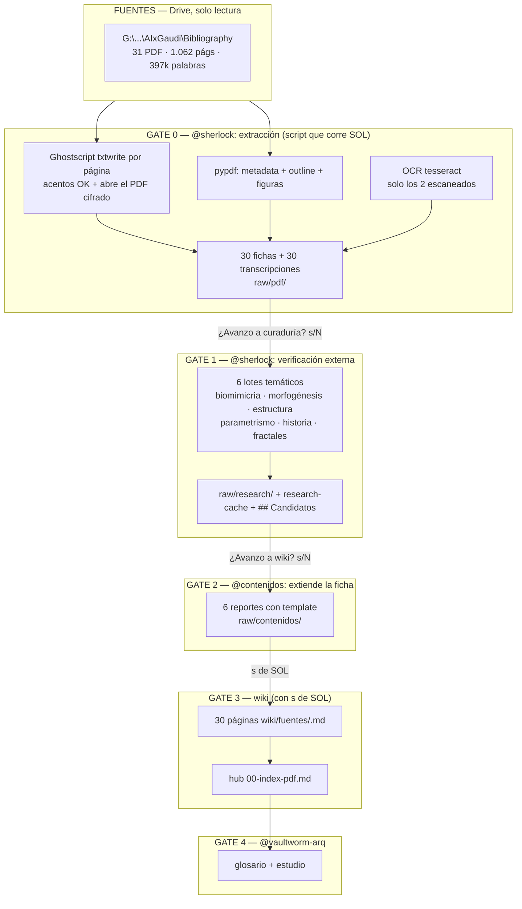

# Plan — Procesado de las fuentes PDF de Gaudí (AIxGaudi) hasta `wiki/fuentes`

> Revisión prevista: **miércoles 21/10/2026 con Emilia**. Origen: carpeta `G:\Mi unidad\OS-Emilia\AIxGaudi\Bibliography` (31 PDF = 30 fuentes + 1 índice), leída en solo lectura. El Drive no se altera en ningún paso.
>
> Relacionado: [[specs/261019-plan-concurso-gaudi-nexus-ia|concurso Gaudí Nexus]] §1.2 (el concurso pide *lógica constructiva paramétrica de Gaudí* y un modelo entrenado con artículos de la Fundació Antoni Gaudí → esta bibliografía es el corpus natural del estudio) · [[wiki/glosario/interno/pbooks/pbk-agentes-vaultarq|pbk-agentes-vaultarq]] · [[wiki/glosario/interno/pbooks/pbk-sherlock|pbk-sherlock]] · `raw/pdf/` (molde de la ficha Baudrillard).

---

## 1. SPEC

### 1.1 Objetivo

Convertir 30 PDFs de bibliografía sobre Gaudí (biomimicria, morfogénesis, estructura, parametrismo, historia) en **fuentes curadas de la wiki**, con el flujo de siempre: extracción cruda → `@sherlock` (exterior) → `@contenidos` (formato legible) → `wiki/fuentes` → `@vaultworm-arq` (glosario). Todo con HITL en cada gate y sin que ningún PDF entre a git.

### 1.2 El molde ya existe (no inventamos nada)

| Pieza | Dónde | Estado |
|---|---|---|
| Ficha de extracción | `raw/pdf/2026-10-13-baudrillard-1994-ficha.md` | probada con 1 libro |
| Índice de fichas | `raw/pdf/00-index.md` | vivo (2 filas) |
| Copia de trabajo del binario | `activos/fuentes/<slug>/` | gitignored |
| Reporte legible | `raw/contenidos/_template.md` | template de 11 secciones |
| Grafo de referencia | `scripts/grafo-yt-vr.html` + `diagramas/agentes-fuentes.mmd` | a replicar para PDF |

### 1.3 Alcance

- **Dentro**: los 30 PDF de la carpeta + el índice `0. INDEX.pdf`; extracción de texto; 6 lotes temáticos de investigación exterior; 6 reportes legibles; 28-30 páginas curadas en `wiki/fuentes/`; el grafo del pipeline como ejemplo del procesado de fuentes.
- **Fuera**: descargar nada de internet (solo lectura de lo local + búsqueda de metadatos), mover o editar los PDF del Drive, publicar nada, y el tren de `wiki/glosario/` (lo decide `@vaultworm-arq` con su propio `s`).

### 1.4 Criterios de cierre

1. `raw/pdf/` con 30 fichas + 30 transcripciones + índice al día.
2. `raw/research/` con 6 informes de @sherlock (referencias verificables, sin 404).
3. `raw/contenidos/` con 6 reportes legibles (template completo).
4. `wiki/fuentes/` con las páginas curadas + un hub `00-index-pdf.md` agrupado por tema.
5. `wiki/glosario/` con los conceptos que surjan (biomimicria, morfogénesis, catenaria, ruled surfaces…) — vía `@vaultworm-arq`.
6. El grafo del pipeline publicado en la wiki como ejemplo de procesado de fuentes.

### 1.5 Decisiones ya tomadas por SOL

| Decisión | Valor | Motivo |
|---|---|---|
| **A. Transcripción** | Completa, versionada en `raw/pdf/<slug>-transcripcion.md` | Se busca dentro del repo; el flujo se lee sin salir de Obsidian. Cada archivo lleva aviso de copyright en el frontmatter. |
| **B. Imágenes** | Cero extracción: la ficha lista las figuras con su página y remite al PDF | El PDF ya está en `activos/`; duplicar 1.700 imágenes no aporta. La wiki guarda la *referencia*, no el peso. |
| **C. Binarios** | Copia a `activos/fuentes/<slug>/` (fuera de git); el Drive queda intacto | Precedente Baudrillard; el repo queda liviano. |
| **D. Extracción** | Ghostscript `txtwrite` por página; `pypdf` para metadata/outline | `pypdf` destruye los acentos (fonts Type1 sin `fontTools`) y no abre el PDF cifrado AES; Ghostscript resuelve ambos. |

---

## 2. Estado real del corpus (medido, no supuesto)

**31 PDF · 1.062 páginas · ~397.000 palabras · ~1.700 imágenes embebidas.**

| # | PDF | Págs | Palabras | Texto | Cluster |
|---|---|---|---|---|---|
| 1 | An Exploration into Biomimicry and its Application into Digital and Parametric Architecture Design | 203 | 46.934 | 192/203 | biomimicria |
| 2 | SUNG, Y. — Beyond Aesthetics: Antoni Gaudí's Revolutionary Use of Biomimicry | 92 | 20.042 | 92/92 | biomimicria |
| 3 | READING GAUDÍ'S GREAT BOOK OF NATURE | 33 | 9.287 | 33/33 | biomimicria |
| 4 | Back to the Basics: Return to the Origin, Gaudí and Nature | 14 | 5.827 | 14/14 | biomimicria |
| 5 | Gaudi und Natur | 8 | 4.814 | 8/8 | biomimicria |
| 6 | Matching nature with 'Complex Geometry' | 10 | 3.903 | 10/10 | biomimicria |
| 7 | Using Nature in Architecture: A perspective | 5 | 2.710 | 5/5 | biomimicria |
| 8 | Gaudí's approach to building | 10 | 4.988 | 10/10 | biomimicria |
| 9 | Towards Morphogenesis in Architecture | 30 | 10.347 | 30/30 | morfogénesis |
| 10 | La arquitectura y la naturaleza compleja | 218 | 82.024 | 216/218 | morfogénesis (libro) |
| 11 | Gaudi_Morphogenesis | 49 | 16.867 | 49/49 | morfogénesis |
| 12 | Challenges in teaching architectural morphogenesis | 16 | 6.308 | 16/16 | morfogénesis (didáctica) |
| 13 | Between Designer and Design | 5 | 3.202 | 5/5 | morfogénesis |
| 14 | LA ARQUITECTURA ESCULTORICA DE ANTONIO GAUDI | 6 | 3.186 | 6/6 | morfogénesis |
| 15 | **Morphogenesis** | 29 | **0** | **0/29** | morfogénesis — **escaneado → OCR** |
| 16 | Structural Analysis of Masonry Historical Constructions | 42 | 14.093 | 42/42 | estructura |
| 17 | Structural Design in the Work of Gaudi | 16 | 8.076 | 16/16 | estructura |
| 18 | LOPEZ 2018 IJAH — tile vaults with reinforcement and concrete | 18 | 9.246 | 18/18 | estructura |
| 19 | Linking Hanging Chain Models to Fabrication | 17 | 5.919 | 17/17 | estructura/paramétrico |
| 20 | Dynamical structural modelling | 16 | 4.171 | 16/16 | estructura |
| 21 | HUERTA, S. — The mechanics of timbrel vaults | 2 | 318 | 2/2 | estructura |
| 22 | Gaudi and CAD (Burry & Burry, *ITcon* 11, 2006) | 10 | 5.526 | 10/10 | paramétrico |
| 23 | BURRY, M. — Antoni Gaudí and Frei Otto: precursors to the Parametricism Manifesto | 6 | 2.129 | 6/6 | paramétrico |
| 24 | Bio Inspired Design Approach Analysis | 7 | 3.642 | 7/7 | paramétrico |
| 25 | El Park Güell i els seus orígens, 1894-1926 | 123 | 99.096 | 119/123 | historia/obra (catalán) |
| 26 | Antonio Gaudí precursor de la sostenibilidad en la arquitectura (tesis UPM, Salas Mirat 2018) | — | — | **cifrado AES** | historia/tesis |
| 27 | Anuario1923 | 21 | 6.826 | 21/21 | historia |
| 28 | Gaudí's La Pedrera, sustainable masonry building | 8 | 3.921 | 8/8 | historia/masonry |
| 29 | Tomlow, J. — Gaudí's reluctant attitude toward… | 15 | **0** | **0/15** | historia — **escaneado → OCR** |
| 30 | Tree-inspired dendriforms and fractal-like | 26 | 12.853 | 26/26 | fractales/árboles |
| — | 0. INDEX.pdf | 7 | 933 | 7/7 | índice de la carpeta |

**Hallazgos técnicos (verificados en la máquina, no supuestos):**

- `pypdf` **no** abre el PDF de la tesis UPM (AES: `cryptography>=3.1` ausente). **Ghostscript sí lo abre** y extrae el texto (comprobado: "UNIVERSIDAD POLITÉCNICA DE MADRID… TESIS DOCTORAL… AÑO 2018").
- `pypdf` degrada los acentos en documentos con fonts Type1: devuelve `GAUD�` donde Ghostscript devuelve `GAUDÍ`. Por eso Ghostscript es el extractor principal.
- `La arquitectura y la naturaleza compleja.pdf` está cifrado pero con contraseña vacía: abre bien.
- `Morphogenesis.pdf` y `Tomlow…pdf` son **escaneos puros** (0 palabras, 1 imagen por página): requieren OCR.
- Tesseract disponible con `eng` + `spa` (**sin `cat`** → el catalán de *El Park Güell* sale degradado).
- Ghostscript rinde ~0,16 s/página → las 1.062 páginas en ~3 minutos.

---

## 3. Pipeline con HITL (las incumbencias, sin pisarse)

```
G:\Mi unidad\OS-Emilia\AIxGaudi\Bibliography\*.pdf        (SOLO LECTURA, nunca se altera)
        │
        │ GATE 0 — @sherlock: extracción cruda (script que corre SOL)
        ▼
raw/pdf/<slug>-ficha.md  +  raw/pdf/<slug>-transcripcion.md  +  activos/fuentes/<slug>/
        │                            (fuera de git)
        │ GATE 1 — @sherlock: verificación externa (websearch/webfetch)
        │   qué es cada obra, edición oficial, DOI/ISBN, papers derivados,
        │   versión digital disponible para los escaneados
        ▼
raw/research/2026-10-2X-<lote>.md  (6 lotes)  +  raw/research-cache/<lote>.json
        │                            "¿Avanzo a curaduría? s/N"
        │ GATE 2 — @contenidos: FORMATEA (template de 11 secciones)
        ▼
raw/contenidos/2026-10-2X-<lote>.md  (6 reportes)
        │                            "¿Avanzo a wiki? s/N"
        │ GATE 3 — @contenidos con `s` de SOL
        ▼
wiki/fuentes/<slug>.md  (30 páginas curadas)  +  wiki/fuentes/00-index-pdf.md
        │
        │ GATE 4 — @vaultworm-arq (1 vez/semana, su propio `s`)
        ▼
wiki/glosario/**  (conceptos)  +  wiki/estudio/**  (metodología)
```

**Quién puede escribir dónde** (delimitado, sin Exceptions):

| Actor | Escribe | NO escribe |
|---|---|---|
| `@sherlock` | `raw/research/`, `raw/research-cache/`, `raw/pdf/` (transcripción + ficha), stub `raw/contenidos/sherlock-*.md` | `wiki/`, reporte legible de `raw/contenidos/` |
| `@contenidos` | `raw/contenidos/` (reporte legible), `wiki/fuentes/` | `wiki/estudio/`, `wiki/glosario/`, `raw/pdf/` |
| `@vaultworm-arq` | `wiki/glosario/**`, `wiki/estudio/**` | `raw/` |
| Yo (orquestador) | `raw/pdf/`, `scripts/`, `diagramas/`, `specs/` | `wiki/` sin tu `s` |

**La frontera es una ficha de extracción aprobada por SOL.** `@sherlock` termina cuando la fuente está bajada y extraída (transcript + ficha); `@contenidos` empieza con tu `s` sobre esa ficha y la **extiende** (template, resumen, destinos, tags). Nadie re-extrae lo que el otro ya hizo.

**Fuentes que abren fuentes (regla de candidatos).** Las citas de una ficha no se convierten en fichas solas:
1. **Nivel 1 — verificar**: `@sherlock` comprueba existencia (DOI/URL/editorial) y lo reporta. Sin ficha nueva.
2. **Nivel 2 — candidato**: se listan en `## Candidatos` (título, año, por qué importa, ¿acceso abierto?) y esperan tu OK; solo entonces se baja y se crea ficha.
3. **Nivel 3 — citas de citas**: solo con `s` explícito por fuente; nunca encadenado.
Un **contenedor** (special issue, número de revista, repositorio, playlist) no es fuente: se registra como *hub* con URL y sus papers son candidatos. Ejemplo: `https://itcon.org/special-issue/2005cadimpact`.

**Los 6 lotes temáticos** para @sherlock (8 + 7 + 6 + 3 + 5 + 1 = 30). Se agrupan por tema, no PDF por PDF, para que la investigación rinda citas cruzadas en vez de 30 informes sueltos.

| Lote | Tema | PDF |
|---|---|---|
| L1 | Biomimicria y naturaleza | 8 |
| L2 | Morfogénesis | 7 |
| L3 | Estructura y masonry | 6 |
| L4 | Parametrismo y CAD | 3 |
| L5 | Historia y obra | 5 |
| L6 | Fractales y dendriticidad | 1 |

---

## 4. TASKS

> Convención del vault: subtasks ≤ 25 min (pomodoros), 16/día por persona.

| # | Task | Owner | Gate | Salida | Pom |
|---|---|---|---|---|---|
| T1 | Reescribir `scripts/pdf_scan_bibliografia.py`: Ghostscript por página, `pypdf` para metadata/outline, sin imágenes, OCR opcional | yo + SOL ejecuta | s | script + `_notas.md` | 2 | ✅ hecho |
| T2 | Correr los 31 PDF → fichas + transcripciones + filas en `raw/pdf/00-index.md` | yo + SOL ejecuta | s | 60 archivos en `raw/pdf/` + `activos/fuentes/` (~130 MB) | 1 | ✅ hecho |
| T3 | OCR de los 2 escaneados (render gs 200 dpi + tesseract) | yo + SOL ejecuta | s | 2 transcripciones marcadas `[OCR]` | 1 | ✅ hecho |
| T4 | @sherlock L1 biomimicria | @sherlock | s | `raw/research/` + cache | 2 |
| T5 | @sherlock L2 morfogénesis | @sherlock | s | ídem | 2 |
| T6 | @sherlock L3 estructura | @sherlock | s | ídem | 2 |
| T7 | @sherlock L4 parametrismo | @sherlock | s | ídem | 1 |
| T8 | @sherlock L5 historia y obra | @sherlock | s | ídem | 2 |
| T9 | @sherlock L6 fractales | @sherlock | s | ídem | 1 |
| T10 | @contenidos L1–L6 (6 reportes con el template) | @contenidos | s | `raw/contenidos/` ×6 | 9 |
| T11 | @contenidos con `s` → `wiki/fuentes/` (30 páginas + hub `00-index-pdf.md`) | @contenidos | **s de SOL** | wiki | 5 |
| T12 | Grafo: `diagramas/pipeline-pdfs-gaudi.mmd` + `.excalidraw.md`/`.png` + `scripts/grafo-pdfs-gaudi.html` (VR) | yo | s | 3 piezas | 3 |
| T13 | Publicar el grafo en la wiki como ejemplo del procesado de fuentes | @vaultworm-arq | s | 1 página con diagrama | 1 |
| T14 | @vaultworm-arq → glosario + estudio (biomimicria, morfogénesis, catenaria, ruled surfaces, parámetro) | @vaultworm-arq | s | 4-6 páginas | 3 |
| T15 | Cierre: `raw/sessions/2026-10-2X-sesion-procesado-pdfs-gaudi.md` + `pbk-agentes-vaultarq` actualizado | yo | — | sesión + pbook | 1 |

**Total estimado: ~36 pomodoros (~15 h).** Reparto posible: T1-T3 y T12-T15 a SOL; T4-T9 a @sherlock; T10-T11 a @contenidos; T14 a @vaultworm-arq.

### Gate 0 — resultados medidos (2026-10-20)

| Métrica | Medido | Nota |
|---|---|---|
| PDF procesados | **31** | 30 fuentes + `0. INDEX.pdf` (el índice maestro del curso) |
| Fichas | **32** | 31 del lote + Baudrillard (piloto previo, 2026-10-13) |
| Transcripciones | **31** | `raw/pdf/<slug>-transcripcion.md`, marcador `## [p. N]` |
| Páginas | **1.062** | |
| Palabras | **~479.000** | |
| Binarios copiados | **31 carpetas / 116 MB** | `activos/fuentes/`, gitignored; Drive intacto |
| OCR | **2 PDF** | *Morphogenesis* (29 p, Korra/UNM 2017) y *Tomlow* (15 p, *Engineering History and Heritage* 164/EH4) |
| PDF cifrado AES | **1** | Tesis UPM 396 p / 79.374 palabras / 97 % — Ghostscript la abre, `pypdf` no |
| Títulos provisionales | **7** | venían como artefacto de Word (`Microsoft Word - ...`, `Title of paper`); los resuelve @sherlock |
| Fichas v1 archivadas | **1** | piloto *Gaudi and CAD* movido a `raw/pdf/_v1/` |

**Desvíos respecto del plan:** (a) el corpus real son 31 PDF, no 28; (b) el peso es 116 MB, no ~130 MB;
(c) `tesseract` solo tiene `eng`+`spa` → *El Park Güell* (catalán) queda aproximado; (d) la extracción
de figuras se descartó por completo (decisión B): la ficha las lista por página y remite al PDF.

**Incidente:** la corrida se percibió "colgada" porque el script no imprimía progreso y Ghostscript
tarda ~2 s/página. Se verificó que no había proceso huérfano: el lote había terminado. Lección: imprimir
progreso por página en futuras corridas largas.

---

## 5. El grafo (3 piezas, como el de las fuentes que ya tenés)

**(a) `diagramas/pipeline-pdfs-gaudi.mmd`** — se lee directo en Obsidian:



**(b) `diagramas/pipeline-pdfs-gaudi.excalidraw.md` + `.png`** — versión editable (skill `excalidraw`; el `.png` ya está en `.gitignore`).

**(c) `scripts/grafo-pdfs-gaudi.html`** — **VR 3D** al estilo de `scripts/grafo-yt-vr.html`: nodos = 30 PDF + 6 clusters + destinos wiki, aristas = tema/autor común, filtro Obsidian `path: wiki/fuentes`, editable en Quest, persistido en `localStorage`.

---

## 6. Riesgos y avisos honestos

| # | Riesgo | Mitigación |
|---|---|---|
| R1 | Las transcripciones versionadas meten ~2,6 MB de texto con copyright en el repo (decisión A) | Cada archivo lleva `aviso: texto con copyright — uso interno, no redistribuir` en el frontmatter; el `raw/` es zona de trabajo, no de publicación. |
| R2 | OCR solo `eng`/`spa`: el catalán de *El Park Güell* sale degradado | Queda anotado `[OCR-degradado]` en la transcripción; @sherlock busca la versión digital oficial para L5. |
| R3 | `pypdf` sin `fontTools` → acentos rotos | Se usa Ghostscript como extractor principal; `pypdf` queda para metadata/outline. |
| R4 | El PDF cifrado AES rompe `pypdf` | Ruta Ghostscript ya verificada sobre ese archivo. |
| R5 | ~130 MB de binarios en `activos/` | Fuera de git por diseño (`.gitignore` → `/activos/`); revisar disco si `P:` aprieta. |
| R6 | 30 páginas nuevas en `wiki/fuentes/` = ruido si no hay índice | Hub `00-index-pdf.md` agrupado por tema + entradas de 1 línea, al estilo de `00-index-yt.md`. |
| R7 | 6 informes de @sherlock el mismo día =urrón | Se hace un lote por sesión, con `s` entre lotes. |

---

## 7. Preguntas para Emilia (miércoles)

1. **¿El corpus completo entra a la wiki, o priorizamos?** 30 páginas es mucho para el hub; ¿dejamos fuera (por ahora) los 8 de biomimicria y los 7 de morfogénesis, que se solapan con la bibliografía de la tesis de neuroarquitectura?
2. **¿Dónde vive la transcripción?** Hoy está en `raw/pdf/` versionada. ¿Se muda a `activos/fuentes/<slug>/transcripcion.md` (fuera de git) cuando el corpus crezca y pese?
3. **¿Regeneramos las figuras como material de trabajo** (render a 150 dpi de las páginas con figuras, ~150-250 MB en `activos/`) para tener material visual propio del estudio, o alcanza con referenciar el PDF?
4. **¿El grafo va a la wiki como ejemplo** (página con el diagrama embebido + el VR html enlazado) o queda como herramienta interna del vault?
5. **¿Encaja esto con el concurso Gaudí Nexus?** Si el modelo del concurso se entrena con artículos de la Fundació Antoni Gaudí, esta bibliografía (30 documentos, 6 temáticos) puede ser el corpus de entrenamiento del estudio: conviene confirmar el alcance.
6. **¿El contexto de trabajo de Emilia en ChatGPT es el corpus crudo (31 PDF) o las fichas procesadas (32 .md)?** Y en qué soporte: la vía viable es un **proyecto compartido de ChatGPT** con la app de Google Drive conectada (los *custom GPT* están en retirada y las cuentas personales ya no pueden crearlos) → plan y pestañas para el 21/10 en `proyectos/STUDIO_OS-Emilia/documentacion/fuentes-contexto-chatgpt-emilia.md` (ítem de Leantime `589`).

---

## 8. Agenda de la sesión del miércoles (45 min)

| Min | Punto | Quién |
|---|---|---|
| 0-5 | Mostrar el grafo (pieza a) y el mapa del corpus | Sol |
| 5-15 | Repasar decisiones A/B/C/D y el riesgo R1 (copyright en git) | Sol + Emilia |
| 15-25 | Responder las 5 preguntas de §7 | Sol + Emilia |
| 25-35 | Definir si arrancamos por L1 (biomimicria) o por L5 (historia, que incluye la tesis y el Park Güell) | Emilia |
| 35-45 | Fijar quién corre qué y en qué sprint (pomodoros) | Sol + Emilia |

---

## 9. Registro de cambios

| Fecha | Cambio |
|---|---|
| 2026-10-20 | Plan creado tras medir el corpus con `pypdf` + Ghostscript. Corrección: son **30 fuentes + 1 índice** (31 PDF), no 28. Decisiones A/B/C/D registradas. |
| 2026-10-21 | Se agrega la **pregunta 6** (§7): el corpus como contexto de ChatGPT para Emilia. Vía elegida: **proyecto compartido + app de Google Drive** (los custom GPT se retiran y las cuentas personales no pueden crearlos). Card `589` en Leantime (proyecto 4, M-A3) con 8 subtareas. Ver `proyectos/STUDIO_OS-Emilia/documentacion/fuentes-contexto-chatgpt-emilia.md`. |
