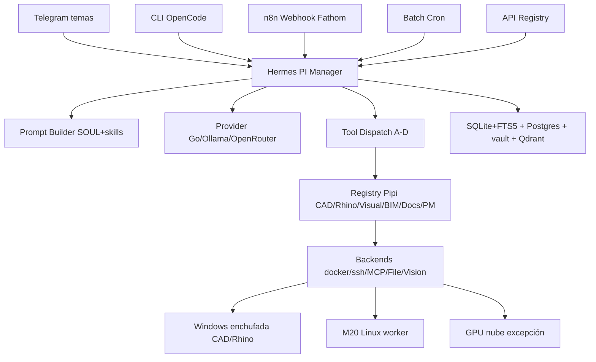

# System Overview PI — del entry point al backend

> Mapea tu diagrama a PI Studio OS. Fuente: [[raw/sessions/2026-11-01-sesion-tabula-rasa-pi|tabula rasa]] + [[specs/261102-plan-maestro-pi-por-temas|plan maestro]] + [[proyectos/MVP_07-studio-os-sistema/ESTRUCTURA|ESTRUCTURA]] + [[proyectos/MVP_07-studio-os-sistema/IMPLEMENTACION-HERMES|IMPLEMENTACION-HERMES]].
> Ingeniería refinada: [[diagramas/pi-system-ingenieria|pi-system-ingenieria C4 + despliegue + secuencia]]. Guion alineado: [[specs/261101-guion-visual-pi-remotion|guion holoarquitecto]].

## Vista texto — la que pediste

```text
┌─────────────────────────────────────────────────────────────────────┐
│                        Entry Points PI                              │
│                                                                     │
│  Telegram (temas por obra)   CLI OpenCode    n8n Webhook (Fathom)    │
│  Batch Cron (digest/recordatorios)   API Registry   Cuaderno móvil  │
└──────────┬──────────────┬───────────────────────┬───────────────────┘
           │              │                       │
           ▼              ▼                       ▼
┌─────────────────────────────────────────────────────────────────────┐
│                     Hermes — PI Manager (VPS)                       │
│                                                                     │
│  ┌──────────────┐  ┌──────────────┐  ┌──────────────┐               │
│  │ Prompt       │  │ Provider     │  │ Tool         │               │
│  │ Builder      │  │ Resolution   │  │ Dispatch     │               │
│  │ SOUL+AGENTS  │  │ Go/Ollama/   │  │ approvals    │               │
│  │ +skills      │  │ OpenRouter   │  │ A-D + deny   │               │
│  └──────┬───────┘  └──────┬───────┘  └──────┬───────┘               │
│         │                 │                 │                       │
│  ┌──────┴───────┐  ┌──────┴───────┐  ┌──────┴───────┐               │
│  │ Compression  │  │ 3 modos      │  │ Tool Registry│               │
│  │ & Caching    │  │ chat · cron  │  │ Pipi CAD     │               │
│  │ MEMORY 2.2k  │  │ webhook      │  │ Pipi Rhino   │               │
│  │ session_search│  │ interactivo  │  │ Pipi Visual  │               │
│  └──────────────┘  └──────────────┘  │ Pipi BIM/Docs/PM│               │
│                                       └──────────────┘               │
└─────────┴─────────────────┴─────────────────┴───────────────────────┘
           │                                    │
           ▼                                    ▼
┌───────────────────┐              ┌──────────────────────┐
│ Session + Memoria │              │ Tool Backends PI     │
│ SQLite+FTS5       │              │ Terminal docker/ssh/ │
│ state.db + cron.db│              │ local (7 modos)      │
│ Postgres negocio  │              │ MCP dinámico:        │
│ vault narrativo   │              │ CAD COM · Rhino 9876 │
│ Qdrant sentido    │              │ Comfy API · Drive    │
│ ledger curador    │              │ n8n · registry       │
└───────────────────┘              │ File Vision OCR      │
                                   └──────────────────────┘
```

## Vista Mermaid — misma info para Obsidian



## Cómo se lee

* **Entry points:** Telegram avanza como puerta diaria, CLI avanza como desarrollo, webhook avanza como eventos, cron avanza como trabajo solo, API avanza como contrato. Todo entra con `chat_id` + `file_ref` + `idem_key`.
* **Agente:** Prompt Builder arma contexto con SOUL + AGENTS del vault + skill justa. Provider elige Go hoy, Ollama local para privado, OpenRouter puntual. Dispatch aplica gobernanza A-D y lista deny dura. Registry expone solo capacidades versionadas.
* **Storage:** SQLite guarda sesión y cron, Postgres guarda negocio con escritor único, vault guarda narrativa, Qdrant guarda sentido, ledger guarda mutaciones de skills.
* **Backends:** Terminal docker/ssh/local ejecuta, MCP dinámico conecta CAD/Rhino/Comfy/Drive/n8n, File/Vision leen PDF/DOCX/croquis con aviso de OCR. Cada backend declara `runner_no_disponible` con motivo en vez de inventar.

## Dónde vive cada pieza

VPS: Hermes + n8n + Postgres + vault canónico + Qdrant. Windows enchufada: AutoCAD + Rhino + puente + runner. M20: worker + espejo + Ollama chico. GPU nube: Comfy y video bajo demanda. Todo por Tailscale, cero puertos públicos.
