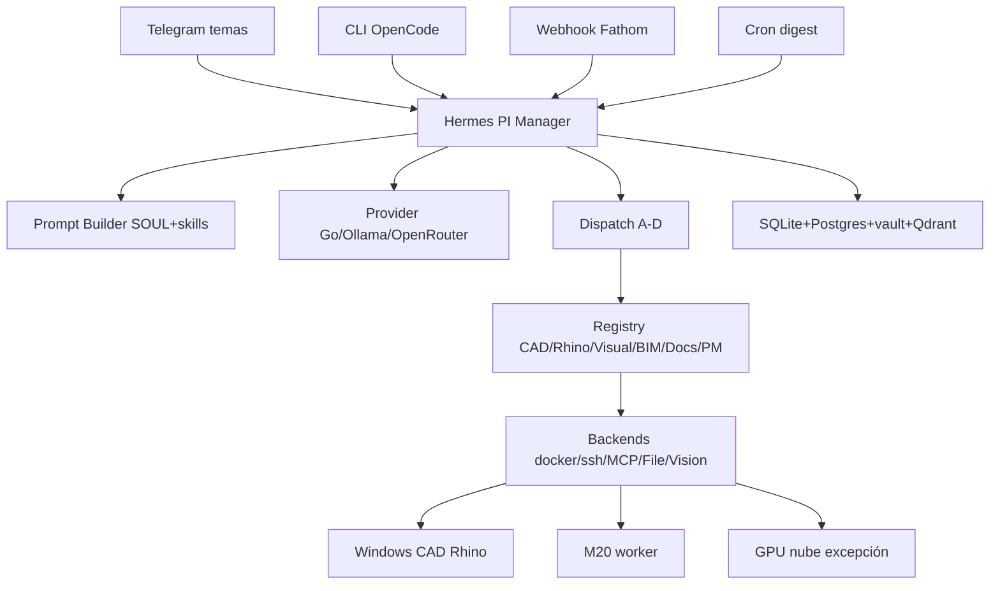

# SPEC 2026-11-11 — Sistema filosófico práctico del estudio

> Integración de todas las ideas de sistema del vault en un documento operable: filosofía + práctica + diagramado, con madurez comparable a práctica europea.
> Fuente primigenia: [[raw/sessions/2026-11-11-sesion-fuerza-motriz-arquitectura|sesión fuerza motriz]] · [[raw/sessions/2026-11-01-sesion-tabula-rasa-pi|tabula rasa Pi]].
> Base vigente intacta: [[proyectos/MVP_07-studio-os-sistema/VISION|VISION]] · [[proyectos/MVP_07-studio-os-sistema/ESTRUCTURA|ESTRUCTURA]] · [[proyectos/MVP_07-studio-os-sistema/REQUISITOS|REQUISITOS]] · [[proyectos/MVP_07-studio-os-sistema/IMPLEMENTACION-HERMES|IMPLEMENTACION-HERMES]].

## 0. Citas humanas intactas

> La fuerza motriz la pone la ejecución del humano. Esta es mi gran tesis de arquitectura. Mis intereses siempre fueron por el humano y la máquina. Donde la fuerza motriz no puede ser el humano. Nosotros lo que necesitamos es la arquitectura de la arquitectura.

> Yo necesito tener separados los aportes del humano. Tener todo el sistema funcionando, los archivos que va a leer la IA, los scripts de Python que necesite, los flujos de N8N. Esas van a ser bracitos de nuestra gente. Yo solo tengo que ver cómo se va construyendo gráficamente.

> El sistema que yo quiero es en el que yo pueda trabajar. Que siempre quede mi cita de mis brillantes entradas.

Lectura guía: citas conservadas palabra por palabra en sesión origen. Interpretación del sistema avanza en secciones siguientes, siempre con aprobación humana explícita.

## 1. Visión filosófica

La IA opera como fuerza motriz que ejecuta trabajo repetible con memoria verificable. El humano dirige con criterio, aprueba con firma y aporta propósito creativo.

La arquitectura de la arquitectura diseña el sistema que diseña: contratos, memoria, registro, cuaderno, portal. Lógica vulcana como madre de ciencias y filosofía, con propósito medido durante seis años.

Tiempo liberado que vuelve al tablero para iterar con alegría, con entrega cuidada y con obra cuidada. Cada hora liberada rinde como hora de diseño.

Referencias vivas: [[specs/261029-filosofia-hermes|filosofía Hermes]] · [[specs/261029-filo-vault-v2|filo-vault-v2]] · [[specs/261110-manifiesto-fundacional-studio-os|manifiesto]] · [[wiki/glosario/conceptos/meta-arquitecto|meta-arquitecto]].

## 2. Principios operativos

* Memoria verificable primero: origen, versión, herramienta, parámetros, responsable y aprobación en cada resultado.
* Automatización primero para lo repetible verificable, IA para interpretar, clasificar y proponer.
* Aprobación humana en C y D, con registro de hash y fecha. Escritura en `wiki/` y ejecución de código avanzan con `s` explícita.
* Formatos abiertos e interoperables: IFC, glTF, SVG, Markdown, con trazabilidad legal según Ley 24.335.
* Modularidad con piezas intercambiables por contrato estable.
* Libre y abierto cuando aporta valor, con licencias comerciales permisivas verificadas.
* Reproducibilidad con semilla, parámetros y log completo.
* Escalabilidad progresiva desde MVP de dos personas hacia mediana escala con desarrollo inmobiliario.

## 3. Arquitectura 4 nodos + contrato

```text
Telegram temas por obra + CLI OpenCode + webhook Fathom + cron + API + cuaderno móvil
  → Hermes VPS como PI Manager
  → n8n + API + MCP hacia Runner y puentes
  → AutoCAD + Rhino+Hops + ComfyUI API + FreeCAD+IfcOpenShell + Unreal futuro
  → Postgres vivo + vault narrativo + Qdrant sentido + registro aprobaciones
```

| Nodo | Vive | Opera |
|---|---|---|
| N1 VPS siempre encendido | Hermes + n8n + Postgres + Leantime + Qdrant + vault canónico | PITAUTECH, con cero puertos públicos y red privada Tailscale |
| N2 PC estudio | AutoCAD completo + Rhino + puente + runner bajo demanda | Estudio, con licencias propias |
| N3 banco pruebas | stack completo para validación con RX 570 | PITAUTECH + estudio, con scripts de solo lectura |
| N4 GPU nube excepción puntual | Comfy 24 GB + video por lote | PITAUTECH, con DPA firmado, volumen cifrado, borrado manual y material derivado trazable |

Contrato único — sobre de tarea:

```json
{
  "task_id": "uuid", "project": "demo", "tool": "audit_dwg", "verbo": "inspect",
  "input": { "file_ref": "vault://pruebas/plano.dwg" },
  "riesgo": "A", "approval": "not_required", "idem_key": "audit:demo:001"
}
```

Reglas del contrato:

* Archivo viaja como `file_ref` resoluble contra vault, con hash verificable.
* Verbo define riesgo mínimo. `publish` siempre avanza como D.
* `idem_key` otorga idempotencia. Reintento con misma clave evita duplicar trabajo.
* Respuesta trae `provenance` completa: versión entrada, herramienta y versión, parámetros, tiempos, costo.
* Tarea con registro previo avanza hacia ejecución. Registro previo como requisito habilitante.

Detalle vigente: [[proyectos/MVP_07-studio-os-sistema/ESTRUCTURA#5 · El contrato entre componentes|ESTRUCTURA §5]] · [[specs/261102-system-overview-pi|system overview]].

## 4. Bracitos operativos — archivos IA + scripts + N8N

### 4.1 Archivos que lee IA — formato máquina

`raw/` como entrada inmutable, con lectura IA y con formato máquina:

* `raw/sessions/` sesiones con voz humana intacta + lectura arquitectura + cerebro-digital.
* `raw/research/` + `raw/research-cache/` informes y caché para consulta.
* `raw/yt/transcripts/` + `raw/referentes/` + `raw/pdf/` + `raw/docs/` fuentes crudas.
* `raw/reuniones/` transcripciones y minutas.
* `raw/contenidos/` + `raw/brainstorm/` + `raw/vaultworm-arq/` reportes de agentes.
* Cache JSON, `state.db`, Qdrant, logs crudos como insumos regenerables.

### 4.2 Archivos que lee humano — formato humano

`wiki/` + `proyectos/` + `specs/` como compilada legible, con escritura IA mediada por `s`:

* Frontmatter obligatorio, wikilinks absolutos, tablas y encabezados exactos.
* Puertas: [[00-index|00-index]] · [[wiki/00-index|wiki]] · [[proyectos/00-index|proyectos]].
* Cuaderno digital como capa visual de wiki, tipo libro horizontal con croquis escaneados.
* Portal iteraciones y dashboard HTML que leen solo archivos humanos.

### 4.3 Scripts Python — mano repetible

Par didáctico `scripts/<slug>.py` runnable + `scripts/<slug>_notas.md` o `_explicado.py` con línea por línea, con comando exacto:

```text
P:\Anaconda\envs\comfyenv\python.exe scripts/<slug>.py
```

Catálogo vigente en [[scripts/00-index|scripts]]: verificación VPS, calibración LoRAs, galería renders, matriz txt2img, inspección Rhino, publicación Hermes.

### 4.4 Flujos N8N — camino determinista

Orquestación para camino repetible verificable, invocada por Hermes por MCP:

* Router Telegram hacia Fuentes-Inbox con ack y extracción Jina con key.
* Webhook Fathom hacia minuta con compromisos con fecha.
* Cron digest 07:00 + recordatorios Telegram + barridos.
* Agenda Cal.com + avisos de salud VPS.

Hermes interpreta y propone. N8N ejecuta camino fijo. Humano aprueba y firma.

## 5. Práctica diaria — 10 pasos + 3 operaciones + gobernanza

Recorrido estudio con sistema activo, según [[proyectos/MVP_07-studio-os-sistema/VISION#2 · El recorrido del trabajo del estudio|VISION §2]]:

| Paso | Sistema | Decide |
|---|---|---|
| Cliente | hoja simple con nombre, contacto, mail y entregas | titular |
| Reunión | Fathom graba, agente agrupa meetings repetidos, minuta con decisiones | titular |
| Compromisos | cada compromiso con entrega y fecha, aviso Telegram, mail con formato casa enviado por persona | titular |
| Cuaderno | escalas, croquis, resultados IA y documentación, cada pieza con referencia | arquitecto |
| Planos | auditoría DWG con informe clasificado, original conservado intacto | arquitecto D |
| Modelo 3D | inspección, medición, ejecución Hops en modo headless, exportación | arquitecto |
| Render IA | agente experto ComfyUI con parámetros y semilla, iteraciones en portal | arquitecto |
| Obra | fotos indexadas con tags, incidencias con resolución | arquitecto |
| Entregas | paquete con índice, envío por persona, registro con fecha | arquitecto D |
| Memoria | cada sesión deja entidades, topics y hechos, Hermes propone mejora | estudio |

Tres operaciones, de manual hacia skill Hermes, según [[specs/261111-sistema-backend-vault-hermes|backend vault]]:

* Ingesta: fuente → ficha → índice → log, con 10-15 archivos tocados por fuente.
* Consulta: respuesta contra compilada con citas de páginas usadas.
* Lint: reporte mensual de contradicciones, huérfanos y huecos, con propuesta.

Gobernanza A-D:

* A lectura automática. B generación aislada en carpeta controlada.
* C modificación con aprobación y copia con reversión.
* D publicación o acción externa con aprobación explícita de versión concreta.

## 6. Diagramado — cómo se ve construyendo

Norma vigente: draw.io para sistema formal, Mermaid para rápido inline, Excalidraw para croquis. Comparativa viva en [[diagramas/prueba-comparativa|prueba comparativa]].



Mapas editables:

* Contexto y stakeholders: [[diagramas/arquitectura-pi-os|arquitectura PI OS]] · [[diagramas/pi-stakeholders|stakeholders]]
* Proceso actual hacia futuro: [[diagramas/pi-bpmn-asis-tobe|BPMN AsIs ToBe]] · [[diagramas/pi-journeys|journeys]]
* Contenedores y componentes: [[diagramas/pi-system-ingenieria-c4|c4]] · [[diagramas/pi-system-ingenieria-componentes|componentes]] · [[diagramas/pi-system-ingenieria-despliegue|despliegue]]
* Datos y flujo: [[diagramas/pi-er-registro|ER registro]] · [[diagramas/pi-maquina-estados|máquina estados]] · [[diagramas/pi-casos-uso|casos uso]]
* Flujo vivo: [[diagramas/flujo-fuentes-wiki-hermes|flujo fuentes wiki Hermes]] · [[diagramas/cerebro-hermes-fractal|cerebro fractal]]
* Ingeniería cerrada: [[diagramas/pi-system-ingenieria|pi-system-ingenieria]]

## 7. Madurez europea + plan + métricas + ADRs

Práctica europea comparte exigencia de trazabilidad, entrega trazable, firma y checklist por jurisdicción, según [[specs/261102-plan-maestro-pi-por-temas#T5 Licencias y legal por jurisdicción|plan maestro T5]]:

| Jurisdicción | Enfoque |
|---|---|
| CABA | código local + encomienda + firma registrada, con plano como documento legal |
| Conurbano | municipio + visado previo, con checklist y plantilla |
| Europa | normativa local + concurso digital con entrega trazable, con licencias verificadas |

Plan T0-T6, según [[proyectos/MVP_07-studio-os-sistema/ESTRUCTURA#9 · Puesta en marcha|ESTRUCTURA §9]]:

* T0 inventario solo lectura. T1 cimientos agente con vault canónico y tailnet.
* T2 contrato y registro con API escritura única. T3 primer motor auditoría DWG caso AIZ.
* T4 interfase Telegram con aprobaciones. T5 imagen con procedencia + cuaderno navegable. T6 piloto obra con entregas.

Métricas:

* Trazabilidad 100% con origen, versión, parámetros y aprobador.
* Fuentes ingestadas contra fichas creadas ≥ 95%.
* Reuniones con minuta ≤ 24h al 100%.
* Junior opera flujo completo con skill, con autonomía creciente.
* Costo por ejecución visible, éxito > 95%.

ADRs vigentes en [[proyectos/MVP_07-studio-os-sistema/ESTRUCTURA#10 · Decisiones técnicas|ESTRUCTURA §10]]: Hermes único, puente P1+P3, registro híbrido Postgres+vault, Runpod Secure como excepción, vault canónico en VPS, Tailscale. Decisiones producto en [[proyectos/MVP_07-studio-os-sistema/VISION#6.9 Las decisiones ya tomadas|VISION §6.9]].

## Referencias verificadas en vault

* [[proyectos/MVP_07-studio-os-sistema/VISION|VISION]] · [[proyectos/MVP_07-studio-os-sistema/ESTRUCTURA|ESTRUCTURA]] · [[proyectos/MVP_07-studio-os-sistema/REQUISITOS|REQUISITOS]] · [[proyectos/MVP_07-studio-os-sistema/IMPLEMENTACION-HERMES|IMPLEMENTACION-HERMES]] · [[proyectos/MVP_07-studio-os-sistema/GUIA-LECTURA|GUIA-LECTURA]]
* [[specs/261101-tabula-rasa-arquitecto-futuro-pi-os|PI OS]] · [[specs/261102-plan-maestro-pi-por-temas|plan maestro]] · [[specs/261102-system-overview-pi|system overview]] · [[specs/261101-guion-visual-pi-remotion|guion holoarquitecto]]
* [[specs/261029-filosofia-hermes|filosofía Hermes]] · [[specs/261029-filo-vault-v2|filo-vault-v2]] · [[specs/261110-manifiesto-fundacional-studio-os|manifiesto]] · [[specs/261111-convergencia-mvps-hermes|convergencia]] · [[specs/261111-sistema-backend-vault-hermes|backend vault]]
* Hermes docs base verificada 2026-10-29 en IMPLEMENTACION §15 y 2026-11-11 en convergencia: `https://hermes-agent.nousresearch.com/docs/` · `https://hermes-agent.nousresearch.com/docs/user-guide/configuration` · `https://hermes-agent.nousresearch.com/docs/user-guide/features/memory` · `https://hermes-agent.nousresearch.com/docs/user-guide/features/skills`
